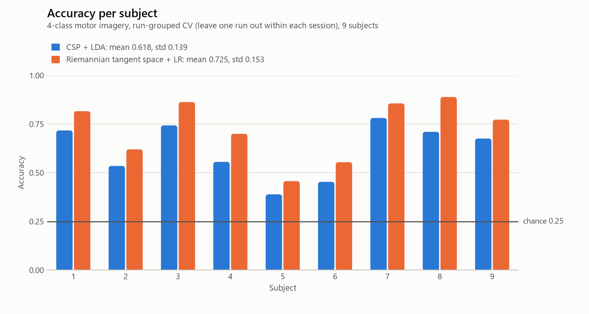
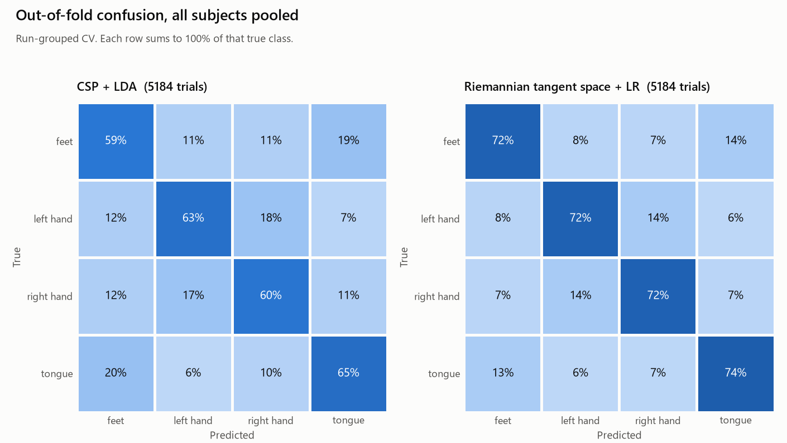

# FINDINGS

The numbers below are taken from the files in `results/`. Environment of the run: Python 3.12.13 on Windows-11-10.0.26200-SP0 (16 logical CPUs).

## Summary

| Protocol | Pipeline | Mean accuracy | Mean kappa |
|---|---|---|---|
| Run-Grouped CV (headline) | CSP + LDA | 0.618 | 0.490 |
| Run-Grouped CV (headline) | Riemannian tangent space + LR | 0.725 | 0.633 |
| CrossSession 0train -> 1test (secondary) | CSP + LDA | 0.551 | 0.402 |
| CrossSession 0train -> 1test (secondary) | Riemannian tangent space + LR | 0.670 | 0.560 |

- Both pipelines are scored per subject on 9 subjects.
  All numbers below are offline decoding accuracy, not real-time performance: no latency was measured.
- The headline is **Run-Grouped CV** (leave one recording run out within each session). The secondary protocol,
  CrossSession 0train -> 1test, is the one used for the baseline comparison (section 5).
- Label-shuffle control: mean accuracy 0.248 to 0.259 across 4 control/pipeline cells (chance 0.25); at chance.
- Baseline: the best CrossSession kappa here is 0.560 (Riemannian tangent space + LR) against the published winner's 0.57, a difference of -0.010. Not like for like; see section 5.
- The leakage audit and the negative control are in sections 6 and 7.

## 1. Dataset, task, chance level

- Dataset: `BNCI2014_001` (BCI Competition IV data set 2a), MOABB 1.7.2, downloaded 2026-10-29.
- Task: 4-class motor imagery (feet, left_hand, right_hand, tongue).
- Subjects used: 9 of 9. Excluded: none.
- Per subject: 576 trials = 2 sessions x 6 runs x 48 trials; epochs of shape (22, 1001) (channels x samples) at 250 Hz.
- Class counts per subject: feet 144, left_hand 144, right_hand 144, tongue 144. The classes are balanced, so the chance level is 1/4 = 0.25 for both accuracy and balanced accuracy.
- Files: 18 `.mat` files hashed with sha256 in `results/dataset_manifest.json`; 18 of 18 are byte-identical between the upstream host and the NEMAR mirror that MOABB actually loads from.

Artifact-flagged trials are kept (MOABB's default `artifact_handling="ignore"`), and no artifact removal of any kind is applied.

## 2. Protocol

**Run-Grouped CV (headline).** For each subject and each session separately, one recording run is held out and the
model is trained on the other runs of that session (`sklearn.model_selection.LeaveOneGroupOut`, groups = run). Run ids
repeat in every session, so the groups are formed inside a session. Run-Grouped CV has 12 folds per subject (2 sessions x 6 runs); each fold trains on 240 trials and tests on 48, and every one of the 576 trials is tested exactly once. CrossSession (0train -> 1test) is one fold per subject that trains on 288 trials and tests on 288.

**CrossSession (secondary).** Train on session 0train, test on session 1test, one direction only. This is the
original BCI Competition IV 2a split (training file `T`, evaluation file `E`).

**What "subject-wise" means here.** Each subject is its own decoding problem: no model ever sees another subject's
data, and subjects are never pooled. It does not measure generalisation to unseen subjects; `CrossSubjectEvaluation`
was not run.

**Why this prevents leakage.** Neighbouring trials of one run share slow drift and non-stationarity. A random-trial
k-fold puts them on both sides of a split and rewards a model for recognising the run. Holding out whole runs removes
that, and the audit (section 6) asserts it on every fold. MOABB's own `WithinSessionEvaluation` uses a shuffled
stratified k-fold over the trials of a session ([docs](https://moabb.neurotechx.com/docs/generated/moabb.evaluations.WithinSessionEvaluation.html)), which does mix runs, so the headline here is
deliberately stricter than that class and its numbers are not expected to match MOABB benchmark tables for it.
MOABB's `CrossSessionEvaluation` ([docs](https://moabb.neurotechx.com/docs/generated/moabb.evaluations.CrossSessionEvaluation.html)) leaves one session out in both directions; this project scores only
the competition direction. Splits are built in `src/eeg/cv.py` rather than by MOABB's evaluation classes because the
audit and the balanced-accuracy scoring need the exact indices and out-of-fold predictions. General MOABB docs: <https://moabb.neurotechx.com/docs/>.

## 3. Pipelines and fixed hyperparameters

Every value was fixed in `SPEC.md` before any run; nothing was tuned, no grid search touches any data, and the configs
are frozen dataclasses that `evaluate()` accepts instead of a search space. Shared preprocessing: MOABB `MotorImagery`,
8-32 Hz band-pass, native sampling rate, epoch window from MOABB's dataset interval.

**CSP + LDA** (`csp_lda`)

| Parameter | Value |
|---|---|
| `n_components` | `4` |
| `reg` | `None` |
| `log` | `True` |
| `norm_trace` | `False` |
| `lda_solver` | `svd` |
| `shrinkage` | `None` |

**Riemannian tangent space + LR** (`riemann_ts_lr`)

| Parameter | Value |
|---|---|
| `cov_estimator` | `oas` |
| `metric` | `riemann` |
| `C` | `1.0` |
| `solver` | `lbfgs` |
| `max_iter` | `1000` |
| `seed` | `42` |

Seed 42. Pinned versions used for the results: moabb 1.7.2, mne 1.13.2, pyriemann 0.12, scikit-learn 1.9.1, numpy 2.5.4, scipy 1.18.1, pandas 3.1.0; Python 3.12.13.

## 4. Results

### 4a. Run-Grouped CV (headline)

| Pipeline | Accuracy (mean ± std) | Kappa (mean ± std) | n subjects | Chance | p vs chance |
|---|---|---|---|---|---|
| CSP + LDA | 0.618 ± 0.139 | 0.490 ± 0.185 | 9 | 0.25 | 0.0020 (1/512) |
| Riemannian tangent space + LR | 0.725 ± 0.153 | 0.633 ± 0.204 | 9 | 0.25 | 0.0020 (1/512) |

Test used: exact one-sided sign-flip permutation test on subject-level accuracy minus chance. Std uses ddof=1.

2 pipelines are tested and no correction is applied to the p-values in the table. A Bonferroni threshold across them is 0.025 (0.05 divided by 2): CSP + LDA: p = 0.0020 (below), Riemannian tangent space + LR: p = 0.0020 (below). The smallest p-value attainable with 9 subjects is 1/512.

Kappa is (accuracy - chance) / (1 - chance); for balanced true classes this equals Cohen's kappa exactly
(`tests/test_aggregate.py` checks it against scikit-learn). Balanced accuracy equals accuracy here because every scored
set is class-balanced. Per subject:

| Subject | Scored trials | CSP + LDA accuracy | CSP + LDA kappa | Riemannian tangent space + LR accuracy | Riemannian tangent space + LR kappa |
|---|---|---|---|---|---|
| 1 | 576 | 0.717 | 0.623 | 0.816 | 0.755 |
| 2 | 576 | 0.535 | 0.380 | 0.620 | 0.493 |
| 3 | 576 | 0.743 | 0.657 | 0.863 | 0.817 |
| 4 | 576 | 0.556 | 0.407 | 0.700 | 0.600 |
| 5 | 576 | 0.389 | 0.185 | 0.457 | 0.275 |
| 6 | 576 | 0.453 | 0.271 | 0.554 | 0.405 |
| 7 | 576 | 0.781 | 0.708 | 0.856 | 0.808 |
| 8 | 576 | 0.710 | 0.613 | 0.889 | 0.852 |
| 9 | 576 | 0.675 | 0.567 | 0.773 | 0.697 |

### 4b. CrossSession 0train -> 1test (secondary)

| Pipeline | Accuracy (mean ± std) | Kappa (mean ± std) | n subjects | Chance | p vs chance |
|---|---|---|---|---|---|
| CSP + LDA | 0.551 ± 0.137 | 0.402 ± 0.183 | 9 | 0.25 | 0.0039 (2/512) |
| Riemannian tangent space + LR | 0.670 ± 0.118 | 0.560 ± 0.157 | 9 | 0.25 | 0.0020 (1/512) |

Test used: exact one-sided sign-flip permutation test on subject-level accuracy minus chance. Std uses ddof=1.

| Subject | Scored trials | CSP + LDA accuracy | CSP + LDA kappa | Riemannian tangent space + LR accuracy | Riemannian tangent space + LR kappa |
|---|---|---|---|---|---|
| 1 | 288 | 0.691 | 0.588 | 0.816 | 0.755 |
| 2 | 288 | 0.490 | 0.319 | 0.562 | 0.417 |
| 3 | 288 | 0.663 | 0.551 | 0.823 | 0.764 |
| 4 | 288 | 0.611 | 0.481 | 0.642 | 0.523 |
| 5 | 288 | 0.247 | -0.005 | 0.490 | 0.319 |
| 6 | 288 | 0.455 | 0.273 | 0.559 | 0.412 |
| 7 | 288 | 0.587 | 0.449 | 0.684 | 0.579 |
| 8 | 288 | 0.590 | 0.454 | 0.688 | 0.583 |
| 9 | 288 | 0.628 | 0.505 | 0.764 | 0.685 |

## 5. Baseline comparison

Source: Tangermann M, Muller KR, Aertsen A, Birbaumer N, Braun C, Brunner C, Leeb R, Mehring C, Miller KJ, Muller-Putz GR, Nolte G, Pfurtscheller G, Preissl H, Schalk G, Schlogl A, Vidaurre C, Waldert S, Blankertz B. Review of the BCI Competition IV. Frontiers in Neuroscience 6:55 (2012). <https://www.frontiersin.org/articles/10.3389/fnins.2012.00055/full> (DOI 10.3389/fnins.2012.00055). Data set 2a, metric: Cohen's kappa (chance level kappa = 0).

> The performance measure kappa was 0.57 averaged over all nine subjects. The other four submissions attained kappa values of 0.52, 0.31, 0.30, and 0.29 and thus were well above chance level of κ = 0.

| Entry | Mean kappa | Source / protocol | This project minus winner |
|---|---|---|---|
| K. K. Ang (winner) | 0.57 | published, Table 3 |  |
| L. Guangquan | 0.52 | published, Table 3 |  |
| W. Song | 0.31 | published, Table 3 |  |
| D. Coyle | 0.30 | published, Table 3 |  |
| J. Wu | 0.29 | published, Table 3 |  |
| CSP + LDA (this project) | 0.402 | CrossSession 0train -> 1test | -0.168 |
| Riemannian tangent space + LR (this project) | 0.560 | CrossSession 0train -> 1test | -0.010 |

The paper reports no per-subject kappa for data set 2a (its per-subject table is for data set 2b), so only the mean over subjects is compared.

**Protocol of the competition** (<https://www.bbci.de/competition/iv/desc_2a.pdf>): training session = A0xT.gdf (labelled). MOABB name: 0train; evaluation session = A0xE.gdf (labels withheld during the competition). MOABB name: 1test; scored on artifact-free trials only; output: a continuous class label for every sample, scored at every time point.

**Why the two numbers are not like for like:**

- This project makes one prediction per trial from a fixed 4 s window after the cue (non-causal: it uses the whole window); the competition scored a causal, per-sample output at every time point.
- The sources do not say how the competition's kappa time course became one number, so the two kappas are not known to measure the same quantity.
- The competition scored artifact-free trials only; this project keeps artifact-flagged trials (MOABB artifact_handling='ignore').
- The competition required EOG artifact removal inside the algorithm; this project does none.
- This project applies a fixed 8-32 Hz band-pass and two fixed pipelines with no tuning; the winner used a filter bank CSP with its own tuned design.
- Kappa here is (accuracy - 0.25) / 0.75 of the pooled single-window predictions, which equals Cohen's kappa for balanced true classes.

The differences are listed, not netted out, so the last column is a raw difference of two numbers that are not known
to measure the same quantity. This project claims neither to beat nor to match the competition result.

## 6. Leakage audit

`src/eeg/leakage.py` runs on every fold of every evaluation and raises `LeakageError` on any violation:

- **(a)** no trial index is on both sides of a split;
- **(b)** no recording run (session + run) is on both sides of a split, and Run-Grouped folds test every trial exactly once;
- **(c)** every `fit` / `fit_transform` of `StandardScaler`, `CSP`, `Covariances`, `TangentSpace`, LDA and logistic
  regression is observed at class level during the evaluation: each must have seen exactly the training-fold row count,
  and any fit handed raw trials must have seen only training trials and none from the test fold (compared by content
  hash, not by position);
- each split holds a single subject, indices are valid and unique, and a run that observes no fit at all is an error.

Limits: only the listed classes are observed; a fit on the right number of rows is content-checked only while the array
still has the raw trial shape; the watcher is not thread-safe, so evaluation is single-process.

**Evidence that it catches a leak.** `tests/test_leakage_catches_leak.py` builds deliberately leaky evaluations
(random-trial split, a run moved into training, a shared index, a dropped fold, mixed subjects, a scaler fitted on all
data, a CSP fitted on test trials with the right row count) and asserts each raises, next to the clean pipelines, which
must pass. The last full `make test` run (2026-10-29, `results/test_results.xml`) executed 65 tests: 65 passed, 0 skipped, 0 failed. Three of those tested a document generator that has since been removed, so the suite now collects 62 tests. `make mutation` reruns `tests/test_leakage_catches_leak.py` with every audit function replaced by a no-op: 8 of 8 deliberately leaky tests then fail, as required, and 5 of 5 clean-pipeline tests still pass. A leak test that passes without the audit would not be testing the audit.

## 7. Negative control

Labels are permuted within each subject and session (fixed seed) and the full pipeline is rerun end to end under both
protocols. Pass criterion: the mean over subjects must be within 0.03 of chance and no subject more than 0.10 above it (smoke run, 2 subjects: 0.10).

| Control | Pipeline | Mean accuracy | Std | Min | Max | n subjects |
|---|---|---|---|---|---|---|
| label_shuffle | CSP + LDA | 0.248 | 0.019 | 0.224 | 0.285 | 9 |
| label_shuffle | Riemannian tangent space + LR | 0.248 | 0.024 | 0.219 | 0.295 | 9 |
| label_shuffle_cross_session | CSP + LDA | 0.253 | 0.018 | 0.219 | 0.278 | 9 |
| label_shuffle_cross_session | Riemannian tangent space + LR | 0.259 | 0.020 | 0.236 | 0.306 | 9 |

Chance level 0.25. **At chance**: no control/pipeline breaks either tolerance.

**What this proves and what it does not.** A leak that carries label information into the test fold would lift
shuffled-label accuracy above chance, so a result at chance shows no such leak in these pipelines under these protocols.
It does not detect a leak that carries no label information (for example fitting a scaler on test data); that is what
the fit-level audit in section 6 is for.

## 8. What didn't work, and what broke

Only two pipelines were run and no other preprocessing was tried, so there is nothing tuned or discarded. What underperformed:

- CSP + LDA, lowest three subjects under Run-Grouped CV: subject 5 (0.389), subject 6 (0.453), subject 2 (0.535).
- CSP + LDA: mean accuracy is 0.066 lower under CrossSession than under Run-Grouped CV.
- CSP + LDA is at or below chance under CrossSession for subject(s) 5 (0.247).
- Riemannian tangent space + LR, lowest three subjects under Run-Grouped CV: subject 5 (0.457), subject 6 (0.554), subject 2 (0.620).
- Riemannian tangent space + LR: mean accuracy is 0.055 lower under CrossSession than under Run-Grouped CV.
- Riemannian tangent space + LR has the higher Run-Grouped accuracy for 9 of 9 subjects. No test of one pipeline against the other was run, so this is descriptive and does not rank the pipelines.

What broke while building this, and the engineering resolution:

- The first `make download` failed on all subjects: MNE refuses a cache directory that does not exist. `data.py` now creates it.
- The first manifest recorded the paradigm band-pass as null (wrong attribute name). It now records `filters`.
- The first label-shuffle control permuted labels across a whole subject, which left the cross-session test set not exactly
  balanced, and `chance_level` correctly refused to score it. Labels are now permuted within each session.
- The first `make test` run exceeded its 90 s budget. Trial hashing now happens once per evaluation and the CI-gate test
  uses one cross-session fold for its true-label check.

## 9. Limitations

- Nine subjects: the subject-level tests have little power and the smallest attainable p-value is bounded by the sign-flip test.
- Non-stationarity: the two sessions were recorded on different days, and CrossSession measures how a model trained on one
  day holds up on the next (the size of the gap to Run-Grouped CV is in section 8). Neither protocol says anything about longer gaps.
- **No artifact removal** (no ICA, ASR or EOG regression), and artifact-flagged trials are kept.
- No cross-subject transfer was run; every model is trained on the subject it is tested on.
- Two fixed pipelines and one band-pass; no hyperparameter was tuned, so these are not the best achievable numbers.
- **No real-time claim.** This is an offline benchmark. No hardware latency was measured and none of the numbers say
  anything about online use.
- The baseline comparison is not like for like (section 5).
- The numbers in this document come from the files in `results/`.
