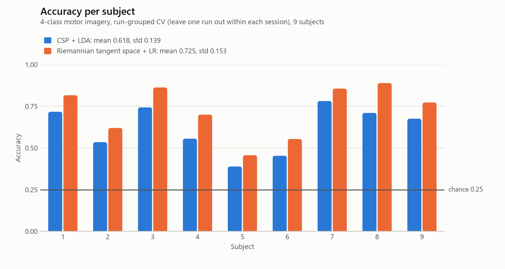
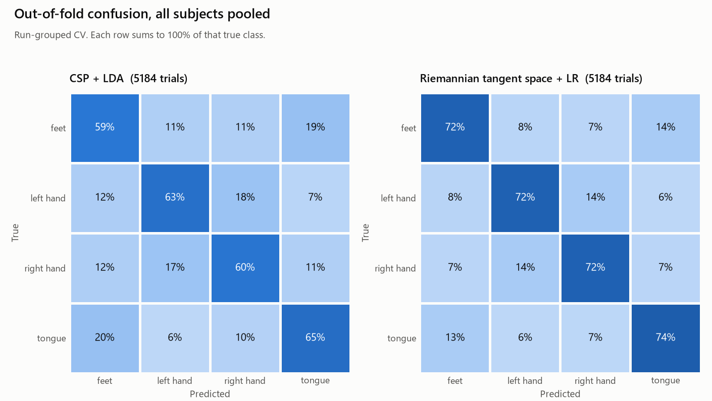

# eeg-moabb

An offline EEG decoding benchmark on one public dataset: BCI Competition IV data set 2a (`BNCI2014_001`), 4-class motor imagery (left hand, right hand, feet, tongue) from 9 subjects, loaded through [MOABB](https://moabb.neurotechx.com/docs/).

Two fixed pipelines are compared: CSP + LDA, and Riemannian tangent space + logistic regression. Each subject is decoded on their own, and nothing is tuned. Most of the work here is in the evaluation: how the folds are built, a check on every fold that no test data reaches a fit, and a control run on shuffled labels.

[FINDINGS.md](FINDINGS.md) has the full write-up. [SPEC.md](SPEC.md) has the scope and settings that were fixed before the runs.

## Results

Mean over the 9 subjects. Chance is 0.25.

| Protocol | Pipeline | Mean accuracy | Mean kappa |
|---|---|---|---|
| Run-Grouped CV (headline) | CSP + LDA | 0.618 | 0.490 |
| Run-Grouped CV (headline) | Riemannian tangent space + LR | 0.725 | 0.633 |
| CrossSession 0train -> 1test (secondary) | CSP + LDA | 0.551 | 0.402 |
| CrossSession 0train -> 1test (secondary) | Riemannian tangent space + LR | 0.670 | 0.560 |

Run-Grouped CV leaves one recording run out within each session, which gives 12 folds per subject. CrossSession trains on the first session and tests on the second, the original competition split. Kappa here is (accuracy - 0.25) / 0.75, which equals Cohen's kappa because the classes are balanced.





The Riemannian pipeline has the higher Run-Grouped accuracy for all 9 subjects. No test of one pipeline against the other was run, so that is a description, not a ranking. Subject 5 is the weakest for both pipelines (0.389 and 0.457), and CSP + LDA is at chance for subject 5 under CrossSession (0.247).

### Against the competition result

On the competition's own split the Riemannian pipeline's mean kappa is 0.560 and CSP + LDA's is 0.402. The competition winner's mean kappa was 0.57 ([Tangermann et al., 2012](https://www.frontiersin.org/articles/10.3389/fnins.2012.00055/full)). These are not the same measurement. The competition scored a causal, per-sample output on artifact-free trials, while this project makes one prediction per trial from a fixed 4 s window and keeps artifact-flagged trials. FINDINGS.md section 5 lists every difference. This project does not claim to beat or match the competition result.

## How leakage is checked

**Folds hold out whole runs.** Neighbouring trials in a run share slow drift, so a random-trial k-fold can reward a model for recognising the run. MOABB's own `WithinSessionEvaluation` uses a shuffled stratified k-fold, which does mix runs, so the numbers here are not expected to match MOABB benchmark tables for it.

**An audit runs on every fold.** `src/eeg/leakage.py` raises `LeakageError` if a trial index or a recording run appears on both sides of a split. It also watches every `fit` and `fit_transform` of `StandardScaler`, `CSP`, `Covariances`, `TangentSpace`, LDA and logistic regression. Each fit must see exactly as many rows as the training fold, and any fit handed raw trials must see no test trial. Only those classes are watched, the content check only applies while the array still has the raw trial shape, and the watcher is not thread-safe, so evaluation runs in a single process.

**The audit is tested against leaks.** `tests/test_leakage_catches_leak.py` builds deliberately leaky evaluations and asserts the audit raises on each. `make mutation` reruns those tests with the audit functions replaced by no-ops: the 8 leaky tests then fail, as they should, and the 5 clean-pipeline tests still pass.

**A label-shuffle control.** Labels are permuted within each subject and session, and the full pipeline is rerun under both protocols. The pass rule: the mean over subjects within 0.03 of chance, and no subject more than 0.10 above it.

| Control | Pipeline | Mean accuracy | Std | Min | Max | n subjects |
|---|---|---|---|---|---|---|
| label_shuffle | CSP + LDA | 0.248 | 0.019 | 0.224 | 0.285 | 9 |
| label_shuffle | Riemannian tangent space + LR | 0.248 | 0.024 | 0.219 | 0.295 | 9 |
| label_shuffle_cross_session | CSP + LDA | 0.253 | 0.018 | 0.219 | 0.278 | 9 |
| label_shuffle_cross_session | Riemannian tangent space + LR | 0.259 | 0.020 | 0.236 | 0.306 | 9 |

Everything sits at chance. That rules out a leak that carries label information into the test fold, for these pipelines and protocols. It does not catch a leak that carries no label information, such as a scaler fitted on test data. The fit-level audit is there for that.

## What this does not show

- It is an offline benchmark. No latency was measured, so nothing here says anything about real-time or online use.
- No artifact removal (no ICA, ASR or EOG regression), and artifact-flagged trials are kept.
- Every model is trained and tested on a single subject. No cross-subject transfer was run.
- Two fixed pipelines and one band-pass (8-32 Hz), with no tuning, so these are not the best achievable numbers.
- Nine subjects is few: the subject-level tests have little power, and the smallest attainable p-value is 1/512.

The rest is in section 9 of FINDINGS.md.

## Reproduce

Needs `uv`. Python 3.12 is what the Makefile asks for, and dependency versions are pinned in `pyproject.toml`. The results in this repository were produced on Windows 11 with Python 3.12.13.

```bash
make install    # venv and pinned dependencies
make download   # fetch BNCI2014_001 and write results/dataset_manifest.json
make run-all    # both pipelines, both protocols, all subjects
make controls   # label-shuffle control
make test       # test suite; tests that need the dataset skip if it is not downloaded
make mutation   # rerun the leakage tests with the audit disabled
```

`make smoke` is a 2-subject run into `results_smoke/`. `make docker` builds an image and `make docker-test` runs the data-free tests inside it.

## Layout

```
src/eeg/    data.py, cv.py, leakage.py, csp_lda.py, riemann.py, evaluate.py, controls.py
tests/      unit tests, leakage tests, label-shuffle gate
scripts/    shell wrappers and the mutation check
results/    per-subject scores, aggregates, figures, dataset manifest, run metadata
```

## License

MIT. See [LICENSE](LICENSE).
